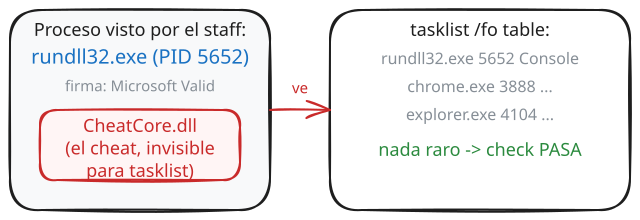
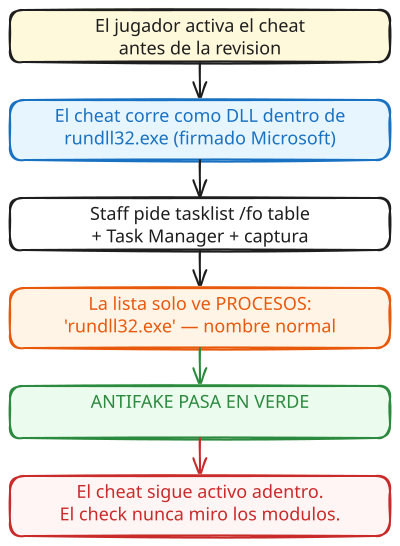
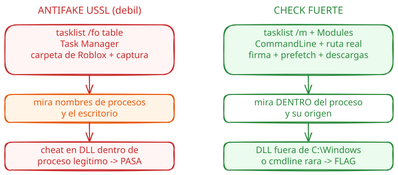

# El antifake de USSL se bypassea. Lo probé en una VM.

> Me mandaron el procedimiento que el staff de la liga corre antes de cada oficial y lo puse a prueba en Windows real. Esto es lo que encontré.

---

El staff de **Ultimate Street Soccer League** revisa al jugador antes de cada oficial de Roblox. El procedimiento es corto y está publicado, así que el jugador lo conoce de memoria:

1. `SHIFT+F5` en el juego para mostrar los FPS, con Roblox en ventana chica.
2. `CTRL+SHIFT+ESC` para abrir el Task Manager y mostrar las apps en segundo plano.
3. `WIN+R` y pegar `%localappdata%\Roblox\GlobalBasicSettings_13.xml` para abrir la carpeta de Roblox.
4. En `cmd`, correr `tasklist /fo table` para listar "toda la actividad" de la PC.
5. Una captura completa con Discord, Roblox, la carpeta y los íconos ocultos de la bandeja, al canal del staff.

Y una regla: no te puedes salir del juego durante la revisión. Si rejoin, se repite todo con un staff mirando.

La idea detrás es razonable a simple vista: si el jugador corre un cheat, debería verse en la lista. El problema es cómo funciona Windows por dentro, y eso es lo que fui a medir.

---

##  La falla de diseño: procesos vs. lo que llevan adentro

`tasklist` lista **procesos**. Un proceso es cada programa corriendo: `chrome.exe`, `Discord.exe`, `RobloxPlayerBeta.exe`. Piénsalo como la lista de autos que entraron a un estacionamiento.

Lo que `tasklist` **no** muestra son los módulos, las DLLs que cada proceso cargó adentro. Una DLL es código que vive dentro de un programa que ya está corriendo. Siguiendo la analogía: es un pasajero que se subió a un auto que ya estaba en el estacionamiento. Desde afuera solo se ve el auto.

Y aquí está el punto: los cheats de Roblox funcionan justamente así. Un executor no es un `cheat.exe` sentado en la bandeja. Inyecta su DLL dentro de `RobloxPlayerBeta.exe` o de cualquier proceso de Windows. En la lista del staff aparece solo el proceso que hace de anfitrión, con nombre y firma de Microsoft si hace falta.

Task Manager es lo mismo. Muestra procesos y apps con ventana, no las DLLs que cada uno lleva adentro. Y la carpeta de `%localappdata%\Roblox` tampoco prueba nada: los cheats no viven ahí. Borras tus archivos antes de la revisión y esa carpeta queda idéntica a la de un inocente.

O sea que los tres pilares del check (tasklist, Task Manager, captura de la carpeta) miran la misma cosa: la superficie. Fui a probarlo.



---

##  El truco: rundll32, el anfitrión perfecto

Windows trae un programa llamado `rundll32.exe`. Es de Microsoft, está firmado por Microsoft, y su único trabajo en la vida es cargar una DLL y correr una función de ella. Es así desde los años 90, todo el mundo lo usa, incluidos los cheats. Es la forma más vieja de correr código sin tener un proceso propio:

```text
rundll32.exe C:\ruta\cualquiera\MiDll.dll,NombreDeLaFuncion
```

Si tu cheat es una DLL, esto es todo lo que necesitas. En `tasklist` aparecerá `rundll32.exe`, nombre de Windows, y nada más.

Para la prueba tomé `shell32.dll` de Windows (una DLL totalmente legit), la copié a mi carpeta de laboratorio con el nombre `CheatCore.dll` y la corrí así:

```text
rundll32.exe C:\antifake-poc\CheatCore.dll,OpenAs_RunDLL
```

Un detalle que salió probando: la primera variante que intenté, `Control_RunDLL`, cargó la DLL y el proceso murió al instante. Para que el truco aguante durante toda la revisión hace falta un punto de entrada que mantenga vivo al proceso. `OpenAs_RunDLL` abre un diálogo que se queda esperando, así que `rundll32.exe` quedó corriendo con PID **5652**, `CheatCore.dll` adentro, durante toda la "revisión".

(Aviso honesto: la DLL que cargué es inofensiva, es una copia byte por byte de `shell32.dll`. Pero el mecanismo es idéntico al de un cheat real: misma técnica, mismo resultado en pantalla.)



---

##  Lo que ve el staff vs. lo que hay de verdad

Con el cheat activo adentro de `rundll32.exe`, corrí el comando exacto del paso 4 del antifake. Esto es lo que sale, extracto del listado real de unos 140 procesos:

```text
Image Name                     PID Session Name        Session#    Mem Usage
========================= ======== ================ =========== ============
RuntimeBroker.exe             4864 Console                    1     14,524 K
RuntimeBroker.exe             3576 Console                    1     22,700 K
RuntimeBroker.exe             5528 Console                    1     15,056 K
chrome.exe                    3888 Console                    1     71,192 K
powershell.exe                6248 Console                    1    101,196 K
rundll32.exe                  5652 Console                    1     12,060 K   <- el cheat vive aqui
OpenWith.exe                  2832 Console                    1     35,416 K
tasklist.exe                  9060 Console                    1      8,968 K
```

Una fila `rundll32.exe`. En la lista de cualquier jugador esa línea no levanta ni una ceja, Windows la genera sola todo el tiempo. El staff mira esto, no ve nada raro, toma la captura y listo. Check en verde con el módulo activo adentro. **El antifake pasa.**

Ahora, tres comandos y se cae todo el truco. Los tres son read-only, no tocan nada:

**Uno:** preguntarle a tasklist por módulos, no por procesos:

```text
> tasklist /m CheatCore.dll

Image Name                     PID Modules
========================= ======== ============================================
rundll32.exe                  5652 CheatCore.dll
```

Ahí aparece `rundll32.exe` con la DLL marcada adentro. El mismo comando que el staff ya usa, con un flag distinto.

**Dos:** la línea de comandos con que arrancó cada proceso:

```text
> Get-CimInstance Win32_Process -Filter "Name='rundll32.exe'" | Select ProcessId,CommandLine

ProcessId CommandLine
--------- -----------
     5652 "C:\Windows\System32\rundll32.exe" C:\antifake-poc\CheatCore.dll,OpenAs_RunDLL ...
```

Está escrito literalmente qué DLL cargó. Un `rundll32` cargando algo que no está en `C:\Windows` es para mirar dos veces.

**Tres:** módulos cargados desde rutas raras:

```text
> Get-Process rundll32 | Select -Expand Modules | ? {$_.FileName -notlike 'C:\Windows\*'}

ModuleName    FileName
----------    --------
CheatCore.dll C:\antifake-poc\CheatCore.dll
```

También probé el segundo truco típico: renombrar el ejecutable con nombre de proceso de Windows, tipo `RuntimeBroker.exe`. En tasklist se ve normal, pero sin abrir nada ya delata tres cosas: el metadato `OriginalFilename` seguía diciendo el nombre original del archivo (renombrar no edita metadatos), corría desde otra carpeta y no tenía firma. Los RuntimeBroker reales de la misma VM viven todos en `C:\Windows\System32` con firma `Valid`. Un "RuntimeBroker" corriendo desde Downloads sin firma no es RuntimeBroker.

Y el dato que empeora todo para el staff: cargué también una DLL escrita en .NET. Resultado: `tasklist /m` **ni siquiera la lista**. Las herramientas nativas de Windows no ven assemblies administrados. Un cheat .NET dentro de un proceso no aparece ni en la lista de procesos ni en la lista básica de módulos. Para verlo hacen falta herramientas CLR de verdad, muy por encima de un `tasklist`.

---

##  Cómo revisar de verdad

Si la liga quiere un check que complique al cheater, esto es lo mínimo. Todo read-only:

```powershell
# Modulos cargados por proceso. El cheat como DLL aparece aqui.
tasklist /m
tasklist /m <nombre-sospechoso>.dll

# Lineas de comando completas. Delata rundll32, regsvr32 y powershell raros.
Get-CimInstance Win32_Process | Select Name,ProcessId,CommandLine | Format-List

# Modulos cargados desde fuera de C:\Windows
Get-Process | Select -Expand Modules | ? {$_.FileName -notlike 'C:\Windows\*'}

# Procesos con nombre de sistema pero ruta rara
Get-Process | Select Name,Path | ? {$_.Path -notlike 'C:\Windows\*'}

# Firma y metadatos del ejecutable
Get-AuthenticodeSignature <ruta>
(Get-Item <ruta>).VersionInfo.OriginalFilename

# Lo que corrio HOY aunque ya no este corriendo
Get-ChildItem C:\Windows\Prefetch\*.pf | Sort LastWriteTime -Desc | Select -First 30
```

Todo eso ya viene armado en `detect.ps1` en esta misma carpeta.

Y tres cambios de fondo, más importantes que cualquier comando:

- **Mirar dentro de `RobloxPlayerBeta.exe`, no solo que existe.** Process Explorer de Sysinternals muestra las DLLs del proceso en vivo. Esa es la revisión real.
- **Screenshare en vivo en vez de captura.** Una foto se toma después de ordenar todo. Un video se ve mientras pasa.
- **Historial en vez de presente.** Prefetch, descargas recientes y el USN journal dicen qué se ejecutó hoy y a qué hora, no solo qué corre ahora.

---

##  Por qué el antifake está flojo

Juntando todo, el diseño tiene tres errores.

**Mide procesos, no código.** La premisa del check es "cheat = proceso visible". Los cheats serios hace años viven como DLL dentro de procesos legítimos. Lo mostré metiendo una DLL dentro de `rundll32.exe`, el nombre más limpio que existe en Windows. `tasklist` está diseñado justamente para no mostrar eso.

**Es un ritual de apariencias.** Carpeta de Roblox abierta, íconos de bandeja, ventana chica, captura bonita. Todo eso mide qué tan ordenado dejó el escritorio el jugador, no qué corre en la PC. Un cheat bien hecho ni toca la carpeta de Roblox.

**Es estático y está avisado.** El jugador conoce el guion completo por adelantado: qué abrir, qué mostrar, qué capturar. Preparar una PC que pase es seguir el mismo guion pero limpiando antes. La regla de no salir del juego cierra solo la vía más tonta. No cierra la carga previa del cheat, ni el cheat en DLL, ni el cheat externo.

Y hay cheats que este check no puede ver ni en su mejor día: macros en el firmware del mouse, autoclickers del software oficial del fabricante como Razer Synapse o Logitech G-Hub, código corriendo en otra PC. Nada de eso genera una fila en `tasklist`.



Veredicto: el antifake es cosmético. Sirve para cachar al jugador que deja su `cheat.exe` abierto en la bandeja y para que el staff parezca que revisa. Contra alguien que sabe lo que hace, `tasklist /fo table` es decoración. La versión que de verdad complica mira módulos, líneas de comando, rutas, firmas e historial.

---

##  Contacto

[](https://discord.com/users/1038423018139037738)

[](https://discord.com/users/1038423018139037738)

<!-- Si la tarjeta no muestra el estado en vivo: unirse al server de Lanyard en discord.gg/lanyard -->
