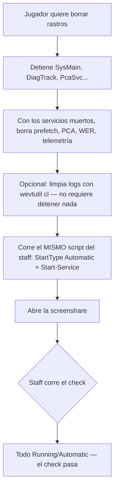
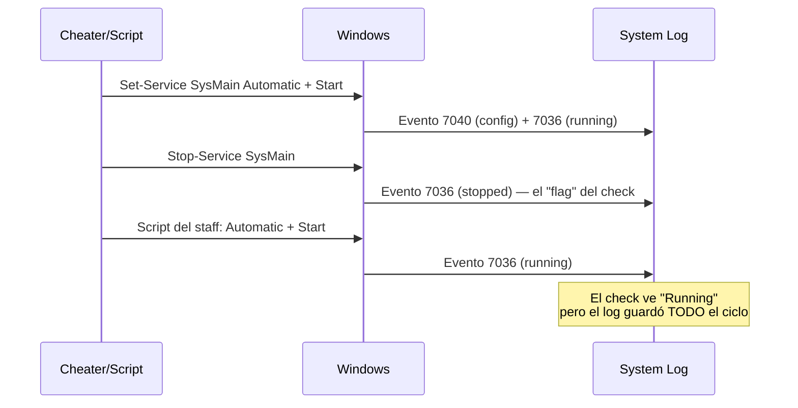
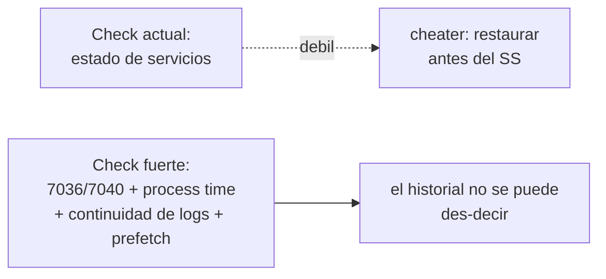

# Check de servicios en una SS: es bypasseable, probado

> Qué chequea el staff, cómo se bypassea en 2 segundos, qué se probó en una máquina Windows real y por qué el método es débil.
> Probado el **2026-11-13** en una VM de **Windows Server 2022 (10.0.20348)** con PowerShell como administrador.

---

##  Veredicto

**Sí, se bypassea. Lo comprobamos en una VM real.** El check mira cómo están los servicios *en este instante* y nada más. El cheater hace su desastre, corre literalmente el mismo script de "arreglo" que usa el staff, y el check sale en verde. Tarda segundos.

Y no solo es bypasseable: **también marca inocentes**. En la VM limpia, sin tocar nada, 5 de los 8 servicios ya venían `Stopped/Disabled` de fábrica. Con la regla "Stopped = flag", esa PC inocente ya estaría funada.

O sea el método falla para los dos lados: al cheater no lo cacha y al jugador con debloat normal lo acusa.

---

##  1. ¿De qué habla este documento?

En una **SS (screenshare)** el staff revisa la PC de un jugador buscando señales de que borró evidencias antes de la revisión. Uno de los checks más comunes es mirar el estado de ciertos **servicios de Windows**.

Un **servicio** es un programa que corre en segundo plano sin ventana. Varios servicios de Windows se encargan de *registrar lo que pasa en la PC*: qué programas se abrieron, cuándo falló algo, qué hizo el sistema. Si un jugador los apaga, Windows deja de registrar — y puede borrar rastros sin que se generen nuevos.

La regla del check es simple:

> **Si alguno de estos servicios aparece como `Stopped` durante la SS → se considera "logs detenidos" (sospechoso).**

Los servicios vigilados:

| Servicio | Nombre real | Qué registra |
|---|---|---|
| `EventLog` | Windows Event Log | **Todos** los eventos del sistema (el más importante) |
| `SysMain` | SysMain (antes Superfetch) | Genera los archivos **prefetch** (qué .exe se ejecutó y cuándo) |
| `DiagTrack` | Connected User Experiences | Telemetría / diagnósticos de uso |
| `PcaSvc` | Program Compatibility Assistant | Qué programas se ejecutaron (lista PCA) |
| `WerSvc` | Windows Error Reporting | Reportes de crash de programas |
| `DPS` | Diagnostic Policy Service | Diagnósticos del sistema |
| `EventSystem` | COM+ Event System | Distribución de eventos entre programas |
| `Schedule` | Task Scheduler | Qué tareas programadas corrieron |

El check que usa el staff:

```powershell
Get-Service DiagTrack,PcaSvc,DPS,SysMain,EventLog,WerSvc,EventSystem,Schedule -ErrorAction SilentlyContinue | ft Name,Status,StartType -AutoSize
```

Y si algo está detenido, lo "arreglan" con un script que pone cada servicio en `Automatic` (o `Manual` para WerSvc) y lo arranca.

---

##  2. Cómo es el bypass

El check mira **cómo están los servicios AHORA MISMO**. No mira el pasado. Ese es todo el problema.

Entonces el bypass es: **hacer el daño primero, dejar todo bonito después**.



Lo más cómico del método: **el script de "reparación" del staff ES el bypass**. Se lo están dando servido al cheater — cualquiera que haya leído el procedimiento sabe exactamente qué tiene que correr antes de la SS para quedar limpio.

Un cheater más cuidadoso ni siquiera detiene EventLog — para borrar eventos sueltos o logs enteros basta `wevtutil cl <log>`, que funciona con el servicio corriendo.

---

##  3. La prueba real en Windows

Lo probamos en una VM de Windows limpia. Esto fue lo que pasó, en orden:

### 3.1 Primera sorpresa: una PC limpia ya "falla" el check

Sin tocar absolutamente nada, el check mostró esto:

```text
Name         Status StartType
----         ------ ---------
DiagTrack   Stopped  Disabled
DPS         Stopped  Disabled
EventLog    Running Automatic
EventSystem Running Automatic
PcaSvc      Stopped  Disabled
Schedule    Running Automatic
SysMain     Stopped  Disabled
WerSvc      Stopped  Disabled
```

**5 de 8 servicios ya venían Stopped/Disabled** en un Windows recién instalado. Con la regla "Stopped = flag", esta PC limpia ya saldría marcada.

### 3.2 El ciclo del bypass, medido en tiempo real

Se tomó **SysMain** como ejemplo. Se intentó primero con EventSystem, pero Windows se negó a detenerlo sin `-Force` porque tiene el servicio SENS dependiendo de él (dato útil: no todos los servicios se pueden apagar gratis).

La secuencia completa duró **~2 segundos**:



Output real del check en cada momento (fila SysMain):

| Momento | Fila de SysMain en el check | ¿El check la marca? |
|---|---|---|
| Antes del ciclo | `Running Automatic` | No |
| Tras `Stop-Service` | `Stopped Automatic` | **Sí — flag** |
| Tras restauración staff | `Running Automatic` | No — **verde otra vez** |

**Confirmado: el check pasa después de haber tocado el servicio.**

### 3.3 El rastro que quedó

Mientras el check veía "Running", el System log guardó **6 eventos nuevos** del experimento (RecordIds 2861–2866):

```text
13:56:13  2861  7040  Start type de SysMain: disabled -> auto start
13:56:13  2862  7036  SysMain entered the running state
13:56:13  2863  7036  SysMain entered the stopped state     <- el stop
13:56:14  2864  7036  SysMain entered the running state     <- el restore
13:56:14  2865  7036  SysMain entered the stopped state
13:56:14  2866  7040  Start type de SysMain: auto start -> disabled
```

Y el dato más lindo: el proceso del servicio reiniciado arrancó **79.24 minutos después de que la PC se encendió**. O sea, el servicio "nació" hace un minuto, no con la PC — imposible de ocultar sin reiniciar la máquina entera.

---

##  4. Qué rastro deja un bypass real (cómo sí se detecta)

Aunque el check de estado salga en verde, el bypass deja huellas en varios lados:

| Señal | Qué buscar | Por qué delata |
|---|---|---|
| **Eventos 7036** | Stops/starts recientes de estos servicios en el System log | Cada `Stop-Service`/`Start-Service` queda grabado |
| **Eventos 7040** | Cambios de StartType (Disabled→Automatic etc.) | El "arreglo" del cheater también queda grabado |
| **Process StartTime vs boot** | El proceso del servicio arrancó mucho después del encendido | EventLog reiniciado hace 5 min con PC prendida hace 3h = lo reiniciaron |
| **Continuidad de logs** | El evento MÁS VIEJO de cada log vs `LastBootUpTime` | Un log cuyo evento más antiguo es de hace 2 minutos fue limpiado |
| **Eventos 1102 / 104** | "Log cleared" en Security / System | Marca directa de `wevtutil cl` |
| **Prefetch** | Cantidad de `.pf` y sus fechas | Prefetch vacío o todo "de hoy" tras horas de uso = borrado o SysMain apagado |
| **USN Journal / artifacts** | Cambios en archivos del sistema | Delata deletions aunque los logs se limpien |

Comandos clave (todo read-only, no toca nada):

```powershell
# Stops/starts y cambios de StartType recientes
Get-WinEvent -FilterHashtable @{LogName='System'; Id=7036,7040} -MaxEvents 60

# ¿Desde cuándo existe el log? (continuidad)
Get-WinEvent -LogName System -Oldest -MaxEvents 1
Get-WinEvent -LogName Application -Oldest -MaxEvents 1

# ¿Cuándo arrancó el proceso de cada servicio?
Get-CimInstance Win32_Service -Filter "Name='EventLog'" | % { (Get-Process -Id $_.ProcessId).StartTime }
(Get-CimInstance Win32_OperatingSystem).LastBootUpTime

# Prefetch: ¿cuántos .pf y de qué fecha?
Get-ChildItem C:\Windows\Prefetch\*.pf | Measure-Object
Get-ChildItem C:\Windows\Prefetch\*.pf | Sort LastWriteTime | Select -First 1 -Expand LastWriteTime
```

El script completo que recolecta todo esto es **`detect.ps1`**.

---

##  5. El otro problema: falsos positivos

El check no solo se bypassea — también **marca gente inocente**:

- En la VM limpia, **5/8 servicios ya venían Stopped/Disabled** de fábrica.
- **DiagTrack** lo deshabilitan miles de "debloat scripts" de privacidad que la gente corre por costumbre, no por chetos.
- **SysMain** lo apaga gente para mejorar rendimiento.
- Varios servicios son **trigger-start**: arrancan solo cuando se necesitan y se detienen solos. `Stopped` es su estado normal. Para saberlo: `sc.exe qtriggerinfo <servicio>` — si tiene triggers, Stopped puede ser legítimo.
- **WerSvc** queda en `Manual` incluso después del script del staff — "todo Running/Automatic" ni siquiera es el estado correcto esperado.

Tabla veredicto por servicio (observado en la prueba):

| Servicio | ¿Stopped es normal? | ¿Qué hace pararlo? | Residuo si lo tocan |
|---|---|---|---|
| EventLog | Casi nunca — debería estar siempre Running | Apaga TODO el registro de eventos | 7036/7040 + restart del proceso + gaps de log |
| SysMain | Puede estar Disabled por debloat | Deja de generar prefetch | 7036/7040 + prefetch vacío/con fecha de hoy |
| DiagTrack | Muy común Disabled (debloat) | Sin telemetría nueva | 7040 (cambio de StartType) |
| PcaSvc | Trigger-start, Stopped es normal | Sin lista de programas ejecutados | 7036 + archivos PCA ausentes/vacíos |
| WerSvc | Trigger-start/Manual, Stopped es normal | Sin reportes de crash nuevos | 7036 + WER vacío |
| DPS | Depende de la config | Sin diagnósticos | 7036/7040 |
| EventSystem | Difícil de parar (SENS depende) | — | 7036 + cascada de dependents |
| Schedule | Casi nunca | Sin tareas programadas | 7036 |

---

##  6. Crítica al método de SS

El check tal como está diseñado tiene tres errores de fondo:

**1. Mira el presente, no el pasado.** `Get-Service` dice cómo está el servicio *ahora*. Un "Running" no prueba que nunca lo detuvieron, igual que un "Stopped" no prueba que lo detuvo el jugador. Es la diferencia entre preguntar "¿está la luz prendida?" y "¿quién tocó el switch hoy?". El check pregunta lo primero.

**2. Regala la solución al cheater.** Publicar el script de reparación como parte del procedimiento le dice al cheater exactamente qué correr antes de la SS. El antídoto y el bypass son el mismo script.

**3. Confunde estado anormal con malicia.** DiagTrack Disabled es el resultado más común de cualquier debloat de Windows. PcaSvc y WerSvc están Stopped en PCs perfectamente normales porque son trigger-start. La regla "Stopped = flag" tiene una tasa de falsos positivos brutal — lo vimos: una VM virgen ya fallaba el check en 5 servicios.

La versión fuerte del check no mira el estado — mira el historial:



1. `7036`/`7040` recientes → ¿se tocaron servicios hoy?
2. Process start vs boot → ¿se reiniciaron "hace nada"?
3. Evento más viejo del log vs boot → ¿se limpió el log?
4. Prefetch → ¿hay gaps o todo es de hoy?

Ninguna señal sola prueba trampa — el debloat legítimo existe. Pero **la combinación** (servicio reiniciado hace minutos + log joven + prefetch fresco) es muy difícil de explicar sin malicia. Un SS que de verdad quiera cachar tiene que mirar eso, no una tabla de `Get-Service`.

---

##  Contacto

[](https://discord.com/users/1038423018139037738)

[](https://discord.com/users/1038423018139037738)

<!-- Si la tarjeta no muestra tu estado en vivo, únete al server de Lanyard: discord.gg/lanyard -->
