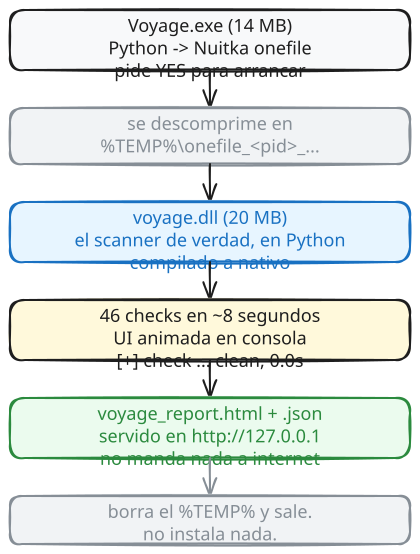
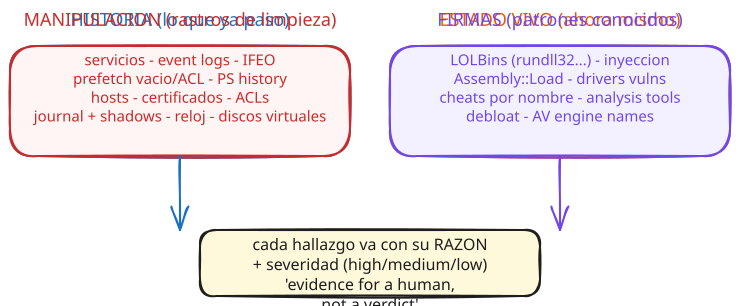
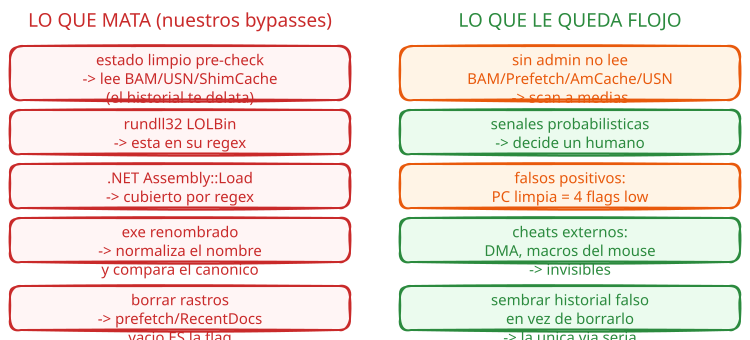

# Voyage.ac: el scanner que sí hace la tarea. Lo abrimos entero.

> Nos llegó un `.exe` de 14 MB con el encargo de "detectá qué es y descompilalo". Resultó ser un scanner de screenshare comercial, y al abrirlo descubrimos por qué los trucos de los dos reportes anteriores no le sirven de nada. Esto es lo que hay adentro, check por check.

---

##  El veredicto, primero

`Voyage.exe` es **Voyage.ac**, un scanner de SS de pago que se usa en ligas de Roblox y shooters. A diferencia del antifake de USSL y del check de servicios, este **sí lee el historial y no solo el presente**. De los bypasses que documentamos antes, todos mueren aquí: el cheat en DLL, rundll32, la carga .NET y hasta el exe renombrado están cubiertos por firmas.

No es imposible de pasar — nada lo es — pero ya no es un ritual de apariencias. Es forense de verdad: corre **46 checks en 8 segundos**, cada hallazgo viene con su razón y su nivel de confianza, y su propio reporte dice *"evidence for a human to review, not a verdict"*. La última palabra la tiene un staff, no el programa. Las vías que le quedan son: correrlo sin admin (queda a medias), cheats que viven fuera del PC, y sembrar historial falso en vez de borrar el real.

Ahora la historia completa.

---

##  Lo que hay dentro del exe

Detect It Easy lo sacó de una:

```
PE64
Packer: Nuitka [OneFile]
Entropy .rdata: 7.99 (packed)
```

Nuitka compila Python a código nativo. En modo *onefile* el `.exe` de 14 MB es solo un bootstrapper: al correrlo, descomprime todo a `%TEMP%\onefile_<pid>_...`, arranca un Python embebido, y al salir borra el directorio. SHA-256 del binario: `1c43e743b7d678f7a6b99178efba7070388e29484c88089e5ce0e75411cdec9e`.

Para sacar el payload sin que lo borrara, corrimos el exe bajo Wine mientras `inotifywait` copiaba cada archivo al instante en que aparecía en `%TEMP%`. Salieron 23 archivos: `python314.dll`, las extensiones estándar, y el premio — **`voyage.dll`, 20 MB, que es el código del autor compilado**. Ese archivo fue el que pasó por Ghidra y por `strings`, y de ahí sale todo lo que sigue.

Del propio binario: está escrito por un dev brasileño (las funciones internas están en portugués: `executar_scan`, `desenhar_scan`, `build_report`), es bilingüe inglés/portugués, y se identifica como *"Made by Voyage.ac Team, v1.0 (Beta)"* con su Discord oficial.



---

##  Qué hace cuando lo corres

Lo ejecutamos en la VM de Windows. El comportamiento real, paso a paso:

1. Muestra un banner ASCII y una advertencia: solo descargarlo de su Discord, porque una copia modificada puede ser maliciosa. Pide `Type YES to continue`.
2. Imprime `Execution confirmed` y arranca el scan con una UI animada en consola: spinner, barra de progreso, y un `[N/46] Checking X...` por cada módulo.
3. Al terminar cada check imprime su resultado: `[+] UserAssist  15 records, 0.0s`.
4. Escribe `voyage_report_<fecha>.html` y `.json`, **levanta un servidor HTTP local** (`http://127.0.0.1:56351/`) y abre el reporte en el navegador.
5. Espera `Press Enter to close...` y se va, dejando el `%TEMP%` limpio.

Output real de la corrida (el archivo completo está en `scan.stdout.clean.txt`):

```
[1/46] Checking System info...
[2/46] Checking Services...
[3/46] Checking BAM/DAM...
[4/46] Checking UserAssist...
[5/46] Checking Prefetch...
...
[46/46] Scan complete.

[+] ShimCache          234 records, 0.0s
[+] UserAssist         15 records, 0.0s
[+] Registry traces    7 records, 0.0s
[+] Services           clean, 0.0s
[+] LOLBins            clean, 0.0s
[+] Kernel drivers     clean, 0.0s
[+] Unloaded modules   clean, 0.0s
... (los 46 resultados en scan.stdout.clean.txt)

Nothing found, but the scan was limited
The scanner ran without administrator rights, so BAM, Prefetch,
AmCache and USN could not be read. Run it again as admin.
Saved report files to C:\lab\voyage\sandbox-work\scan\reports
Opening report: http://127.0.0.1:56351/
```

Dos detalles que dicen mucho del cuidado del programa: **no instala nada** (no crea servicios, drivers ni persistencia — todo vive en el temp que borra al salir) y **no habla con internet** (el único dominio en los 14 MB es su propio Discord; el reporte se queda en tu PC). Si te preocupaba que fuera spyware, no lo es.

---

##  El arsenal: los 46 checks

Esta es la diferencia con todo lo anterior. El antifake de USSL mira una lista de procesos; Voyage mira **cuatro familias de evidencia** en un solo paso:



**Historia (lo que ya pasó):** BAM/DAM, UserAssist, Prefetch parseado con chequeo de salud, ShimCache, AmCache, MuiCache, archivos y memoria de PCA, USN Journal, RecentDocs, Uninstall, FeatureUsage. Son los mismos artefactos que usa la forense real para reconstruir qué ejecutables corrieron y cuándo — aunque el archivo ya no exista.

**Estado vivo (ahora mismo):** procesos corriendo, **memoria de procesos**, **módulos cargados dentro de Roblox**, procesos fantasma, ventanas ocultas (WDA), memoria del propio PcaSvc, DNS cache.

**Manipulación (rastros de limpieza):** servicios parados, event logs apagados o movidos, prefetch vacío, con ACL de deny o dañado, historial de PowerShell vacío/deshabilitado por perfil, ScriptBlockLogging apagado, hijacks de IFEO, hosts y zonas, certificados bloqueados, ACLs de archivos, cambios de reloj, volúmenes desaparecidos, USB conectados en los últimos 14 días, discos virtuales y RAM disks, journal y shadow copies, exclusiones de Everything.

**Firmas (patrones conocidos):** aquí está lo divertido. Del binario salieron sus listas completas:

- **LOLBins:** `rundll32`, `regsvr32`, `mshta` y compañía — con regex sobre la línea de comandos.
- **Inyección:** `VirtualAllocEx|WriteProcessMemory|CreateRemoteThread|NtCreateThreadEx|QueueUserAPC` más `amsiInitFailed` y `AmsiScanBuffer`.
- **`.NET en memoria:** la regex `\[\s*(?:System\.)?Reflection\.Assembly\s*\]::\s*Load(?:File)?\s*\(` — el hueco que `tasklist /m` no veía, tapado.
- **Cheats por nombre:** solara, synapse, sirhurt, serotonin, potassium, dx9ware, nexomia, jjsploit, fluxus, arceusx, madium, isaeva, matrixhub. Y detecta ejecutables **renombrados**: normaliza el nombre quitando `setup|loader|launcher|installer|executor|injector|free|beta|win32|x64` y números de versión, y compara el nombre canónico.
- **Herramientas de análisis:** x64dbg, ollydbg, windbg, procexp, procmon, autoruns, wireshark, fiddler, tcpview, everything, hxd, dumpit, journaltrace, lastactivityview, prefetchview, systeminformer, processhacker, procdump. Tenerlas abiertas ya es una señal.
- **Drivers vulnerables** (los que usan los cheats para leer memoria del kernel): capcom, iqvw64e, kprocesshacker, dbutil_2_3, gdrv, winring0x64, mhyprot2, eneio64, asio3 y una docena más — y chequea el **evento 7045** (servicio nuevo instalado) buscando drivers cargados desde carpetas de usuario.
- **Debloat/privacy tools:** `oosu10|shutup10|ame wizard|atlasos|revios|win11debloat|sophia script|winutil|privacy.sexy` — porque esa categoría de herramientas es la que deja una PC "limpiada".
- **AV por nombre de detección:** `HackTool|Exploit|Trojan|Backdoor|Roblox|Spyware|Injector|Wacatac`.
- Bonus curioso: trackea los dominios de sus competidores (sentinel.ac, ironac.com, cheatwatch.gg, echo.ac y diez más) — si corres otro scanner de la competencia, lo sabe.

---

##  Nuestros bypasses contra Voyage

La tabla honesta. Cada truco que funcionó contra USSL y el check de servicios, contra esto:

| Truco | Qué pasa en Voyage |
|---|---|
| Dejar el estado limpio antes del check | Lee BAM, UserAssist, ShimCache, USN. El historial te delata aunque el presente esté impecable. |
| Cheat como DLL dentro de rundll32 | rundll32 está en la regex de LOLBins y lee la línea de comandos. |
| DLL .NET (invisible para `tasklist /m`) | Regex dedicada a `Assembly::Load`. Cubierto. |
| Exe renombrado a nombre de Windows | Normaliza y compara el nombre canónico. Cubierto. |
| Borrar prefetch/historial/docs recientes | Prefetch vacío, RecentDocs vacío e historial de Run vacío **son flags en sí mismos**. Limpiar es confesar. |



---

##  Dónde flaquea de verdad

Ningún scanner es perfecto y este tampoco. Los puntos honestos:

**Sin admin queda a medias.** En nuestra VM el veredicto fue literalmente `"Nothing found, but the scan was limited"` — sin privilegios no puede leer BAM, Prefetch, AmCache ni el USN Journal, que son sus fuentes más jugosas. Al menos es honesto y se lo dice al staff en el propio reporte, pero si el staff lo corre con doble clic normal, el scan sale capado.

**Marca PCs limpias.** Nuestra VM de prueba, recién instalada y sin tocar, ya levantó 4 flags de score low:

```
- Drive letters were used by volumes that are gone: C:, E:, F:
- TabletInputService is disabled
- RecentDocs registry history is empty
- The Run dialog history is empty
```

Letras de disco "huérfanas" pasan en cualquier PC que haya visto un USB. Un RecentDocs vacío "puede venir de un cleaner" — o de una instalación nueva. Son señales débiles y el programa lo sabe (score low), pero confirma que el falsopositivismo existe y que **el humano que lee el reporte sigue siendo el último filtro**. Un jugador con labia y un reporte de puros "low" tiene margen.

**Lo que no puede ver:** cheats que viven fuera del PC — DMA por hardware, macros en el firmware del mouse, autoclicker del software oficial del fabricante, código corriendo en otra máquina. Nada de eso deja artefactos que revisar.

**Sembrar es mejor que borrar.** Todo el diseño castiga la limpieza: lo vacío, lo denegado, lo apagado son flags. La vía que queda en teoría es la inversa — generar historial legítimo abundante antes del scan, para que los artefactos mientan en vez de faltar. Es mucho más trabajo que apretar un cleaner, pero es la única dirección que no activa sus alarmas de tampering. Y sigue siendo solo teoría.

**Es una beta.** `v1.0 (Beta)` dice el banner. Parsers de BAM/Prefetch/ShimCache tienen quirks por versión de Windows y edge cases que solo salen en PCs reales con años de uso.

---

##  La comparación que importa

| | Antifake USSL | Check de servicios | **Voyage.ac** |
|---|---|---|---|
| Qué mira | La pantalla de hoy | El estado de hoy | **El historial + el estado + las señales de limpieza** |
| Bypass fácil | DLL en proceso legítimo | Borrar y restaurar | **Ninguno de los probados funciona** |
| Falsos positivos | Muchos, sin aviso | Una PC virgen ya falla 5/8 | Pocos, y declara el score de cada uno |
| Decide | La captura | La fila `Stopped` | **Un humano leyendo evidencia** |
| Veredicto | Decoración | Medio filtro | **Forense de verdad** |

Después de burlarnos de dos métodos que medían lo presente y nada más, hay que decirlo en justicia: **Voyage hace exactamente lo que les pedíamos a los otros** — lee historia, detecta la propia limpieza, cubre los gaps de módulos y .NET, y calibra sus hallazgos para no condenar inocentes. Si el staff de una liga corre esto con admin y un humano revisa el reporte, el margen para un cheater se reduce bastante.

La recomendación para cualquier liga seria: el procedimiento de `tasklist` y capturas puede quedarse como paso rápido, pero el criterio real debería ser un scanner de esta clase **corrido con privilegios**, con el staff leyendo el JSON/HTML en vez de confiar en una foto.

---

##  Archivos de este reporte

- `scan.stdout.clean.txt` — el output real del scan en la VM, limpio de animaciones.
- `voyage_report_20261116_050241.json` — el JSON de resultados que generó el programa.
- `img/` — diagramas (excalidraw + svg).

---

##  Contacto

[](https://discord.com/users/1038423018139037738)

[](https://discord.com/users/1038423018139037738)
